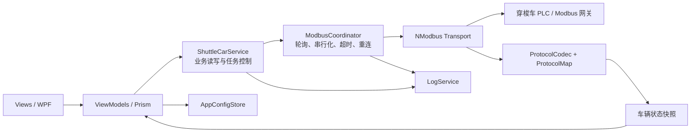
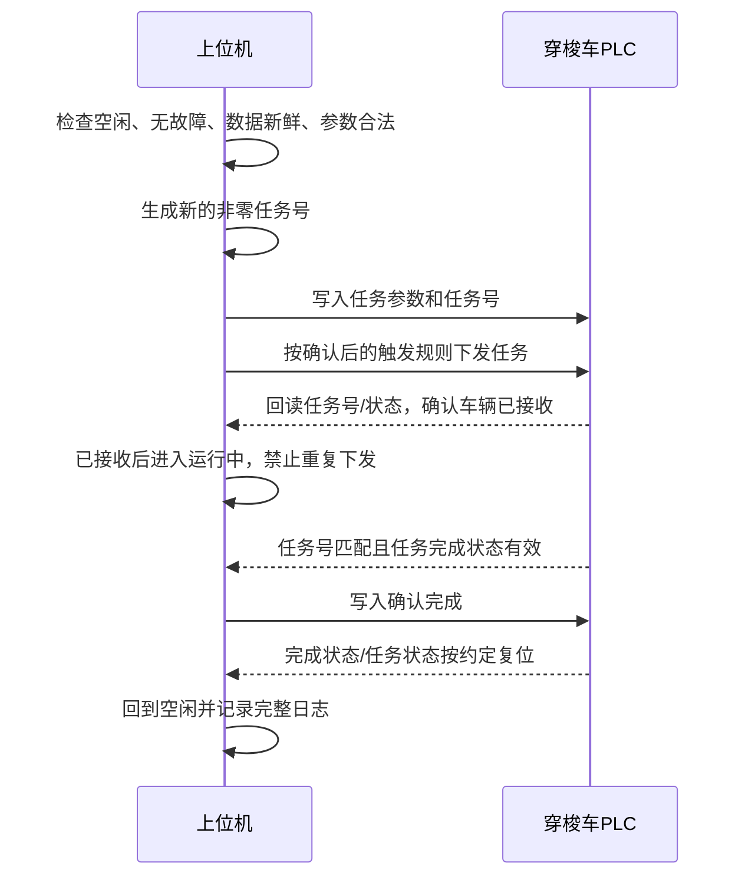

# 二向穿梭车上位机详细开发方案

> 文档版本：V1.0（开发评审稿）  
> 编制日期：2026-11-09  
> 目标项目：`ShuttleCarController`  
> 依据文件：`ShuttleCarController-Readme.md`、`二向车上位机对接协议(1).xlsx`、`二向车上位机控制界面.png`

---

## 1. 文档目的

本方案将现有简要需求细化为可直接用于开发、联调和验收的实施说明，明确：

- 软件保留哪些界面区域，每个区域放什么内容；
- WPF、Prism 与 NModbus 如何分工；
- Excel 中每个 DB 偏移字段如何进入软件模型；
- 通信、轮询、写入、任务握手、异常恢复和日志如何处理；
- 哪些协议信息尚未给出，开发到什么程度后必须暂停并确认；
- 每一阶段交付什么，以及如何判定验收通过。

本方案只描述上位机工具，不设计 PLC 程序，不改变车辆安全回路，不扩展仓库调度系统。

## 2. 需求理解与范围

### 2.1 原始功能到实现的映射

| 原始区域 | 本方案中的具体职责 |
|---|---|
| Modbus 区 | 配置连接参数，执行连接/断开，显示链路状态、最近成功通信时间及错误信息 |
| 基础控制区 | 按功能码、起始地址、数量和数值执行单次读写，用于协议验证与现场调试 |
| 按钮/参数值区 | 使用已封装的业务命令，不再要求操作人员手填寄存器地址 |
| 参数解析区 | 将原始寄存器转换为车辆状态、位置、任务、电量和报警等可读信息 |
| 数据表区 | 同时展示逻辑字段、DB 偏移、原始十六进制值、解析值、数据质量和更新时间 |
| 日志区 | 展示并保存连接、读写、业务命令、报警变化和通信异常记录 |

### 2.2 本期必须完成

1. 单车、单连接、单主站的上位机工具。
2. 默认采用 **Modbus TCP**；最终通信制式仍需硬件方确认。
3. 车辆状态轮询、原始数据查看、业务参数写入、命令结果反馈。
4. 通信中断、超时、非法值、数据过期、车辆报警的软件防护。
5. 配置保存、日志保存、关闭时释放连接。
6. 协议解析自动化测试、Modbus 仿真测试和实车联调。

### 2.3 本期不做

- 多车同时控制、仓库任务分配、路径规划和库存管理；
- 数据库、Web 服务、远程控制、用户权限系统和自动升级；
- 绕开 Modbus 直接实现 Siemens S7 协议；
- 软件“急停”替代物理急停，或屏蔽车辆自身安全保护；
- Excel 中没有定义的手动点动、速度调节、位置示教等运动功能；
- 未确定地址和含义的“沿1～沿15”等信号控制。

## 3. 当前项目基础与技术选择

### 3.1 当前项目情况

现有解决方案已经具备：

- `ShuttleCarController/ShuttleCarController.csproj`：`net10.0-windows`、WPF；
- `NModbus 3.0.83`：Modbus 通信；
- `Prism.DryIoc 9.0.537`：MVVM、依赖注入；
- `Views/MainWindow.xaml` 与 `ViewModels/MainWindowViewModel.cs`：目前仅为空壳。

因此继续在现有工程中开发，不更换框架，不新建另一套应用。

### 3.2 技术约束

- 桌面系统：Windows，x64，Release 发布；
- UI：WPF + MVVM，View 不直接调用 NModbus；
- 通信：NModbus，TCP 默认端口 `502`，站号暂用 `1`，两者均允许配置；
- JSON 配置：使用 .NET 自带的 `System.Text.Json`；
- 日志：先使用 .NET 文件流实现轻量文本日志，不引入数据库或大型日志框架；
- 运行时不新增第三方依赖；测试工程可以使用 xUnit 等测试框架。

### 3.3 设计原则

1. **协议不确定就不猜**：DB 偏移不能直接当作 Modbus 地址。
2. **所有通信串行执行**：同一连接中轮询和写入不能并发占用 `IModbusMaster`。
3. **UI 只读写快照**：后台通信结果先组成不可变快照，再统一更新界面。
4. **读失败可以重试，写失败不自动重发**：避免重复触发车辆动作。
5. **控制依赖新鲜数据**：连接中断或数据过期后禁止发送业务命令。
6. **保留原值**：未知枚举、未定义报警码和保留位均显示原始值，不能静默丢弃。

## 4. 协议分析与联调门槛

### 4.1 Excel 给出的内容

工作簿包含四个工作表：

| 工作表      | 内容                                   | 软件使用方式                           |
| -------- | ------------------------------------ | -------------------------------- |
| 穿梭车发送上位机 | 车辆状态、任务、位置、电量等，DB 字节偏移 `0～38.2`      | 作为车辆状态模型来源                       |
| 上位机发送穿梭车 | 任务类型、任务号、初始化、确认完成等，DB 字节偏移 `0～20.1`  | 作为业务命令模型来源                       |
| 上位机交互    | HMI 状态、故障位、货位状态、电量等，DB 字节偏移 `0～11.7` | 作为交互状态与故障模型来源，是否真实映射到 Modbus 待确认 |
| 上位机对接_DB | 沿1～沿4、沿6～沿15，Bool，无偏移                | 信息不足，本期不接入                       |

原表包含“该表仅供参考”的注释。表内主要信息是 Siemens DB 风格的数据类型和字节偏移，**没有给出完整 Modbus 地址映射、功能码、寄存器顺序及命令握手定义**。

### 4.2 开发前/联调前必须确认的 P0 项

| 编号 | 必须确认的问题 | 未确认时的处理 |
|---|---|---|
| P0-01 | 实际使用 Modbus TCP 还是 RTU；TCP 的 IP、端口、站号 | 仅完成 TCP 默认实现，不声称已适配实车 |
| P0-02 | 三个数据区是否分别映射到 Modbus；各自基地址和寄存器类型 | 不将 DB 偏移直接当地址 |
| P0-03 | 使用保持寄存器还是输入寄存器；读功能码是 `03` 还是 `04` | 基础读写区支持两种读法，业务层暂不定死 |
| P0-04 | 写功能码使用 `06/16`，还是线圈 `05/15` | DB 字/位默认按寄存器方案设计，待 PLC 方确认 |
| P0-05 | 地址是从 0 还是 1 开始，文档地址是否需要减 1 | 通过固定测试值验证后写入 `ProtocolMap` |
| P0-06 | Int/DInt 的字节序、DInt 的字序 | 用已知值完成解码测试后才能显示工程量 |
| P0-07 | `38.1` 这类位偏移到 Modbus 寄存器位的实际对应关系 | 不自行假定高字节/低字节顺序 |
| P0-08 | 任务类型的数值枚举、出库方式数值、车体方向数值 | UI 先保留原始值，不硬编码 `0/1` 的业务含义 |
| P0-09 | 小车状态、报警、巷道状态等 Int 是枚举、位掩码还是错误码 | 未定义前显示十进制和十六进制原值 |
| P0-10 | 任务下发、车辆接收、运行、完成、确认完成的完整时序 | 第 9 节仅作为建议时序，不能替代双方确认 |
| P0-11 | `任务完成(Int@2)` 与 `任务完成_1(Bool@38.0)` 的区别 | 不混用两个字段 |
| P0-12 | `待机中@0.0` 与 `待机@1.0` 等相近字段的区别 | 分开建模、分开显示 |
| P0-13 | 电量比例和单位，小车位置单位，各位置字段是否从 0 或 1 开始 | 未确认前不擅自添加 `%`、毫米等单位 |
| P0-14 | 标注“未写入”的故障位是否已在最新 PLC 程序中生效 | 未生效时显示“未接入”，不能作为验收故障依据 |

### 4.3 地址映射规则

若硬件方确认“DB 每两个字节连续映射为一个 Modbus 寄存器”，则逻辑换算可采用：

```text
寄存器索引 = 区域基地址 + 字节偏移 / 2
Int  占 1 个寄存器
DInt 占连续 2 个寄存器
```

该公式只有在 P0-02～P0-07 全部验证后才能启用。以下逻辑区域长度仅用于检查表内数据范围，不代表实际 Modbus 长度：

| 逻辑区域     |  表内有效范围 | 连续映射时的理论长度 |
| -------- | ------: | ---------: |
| 穿梭车发送上位机 | 字节 0～39 |    20 个寄存器 |
| 上位机发送穿梭车 | 字节 0～21 |    11 个寄存器 |
| 上位机交互    | 字节 0～11 |     6 个寄存器 |

最终地址集中写在一个 `ProtocolMap.cs` 中，并附协议版本和确认日期；本期不开发“寄存器映射编辑器”。

## 5. 总体架构



### 5.1 建议代码结构

```text
ShuttleCarController/
├── App.xaml.cs                         # DI 注册、应用退出清理
├── Views/
│   └── MainWindow.xaml                # 六个功能区域
├── ViewModels/
│   ├── MainWindowViewModel.cs         # 页面组合、全局状态和命令
│   └── LogEntryViewModel.cs           # 如需日志显示转换时使用
├── Models/
│   ├── ConnectionSettings.cs
│   ├── CarStatusSnapshot.cs
│   ├── CommandParameters.cs
│   ├── ModbusDataItem.cs
│   └── LogEntry.cs
├── Services/
│   ├── IShuttleCarService.cs
│   ├── ShuttleCarService.cs           # 面向 ViewModel 的强类型接口
│   ├── ModbusCoordinator.cs           # 唯一通信调度入口
│   ├── ProtocolCodec.cs               # Int/DInt/Bool 解码与编码
│   ├── ProtocolMap.cs                 # 已确认的地址、比例、枚举和位定义
│   ├── AppConfigStore.cs
│   └── LogService.cs
└── Converters/                        # 只放少量通用状态显示转换器
```

不必为六个界面区域建立六套通信服务，也不引入额外插件框架。界面拆分时只做 XAML 分区，通信仍由同一个服务实例负责。

### 5.2 依赖注入生命周期

以下对象注册为单例：

- `ModbusCoordinator`：唯一连接与通信锁；
- `ShuttleCarService`：业务读写入口；
- `LogService`：统一日志队列与文件写入；
- `AppConfigStore`：连接配置的读取和保存；
- 主 ViewModel：由 Prism 按现有方式解析。

`TcpClient`、实际 `IModbusMaster` 由 `ModbusCoordinator` 在连接时创建，在断开和退出时释放，不在 DI 容器中长期保存失效连接。

## 6. 界面功能设计

沿用示意图的六区布局，使用一个主窗口，不增加导航页。

### 6.1 左侧 Modbus 区

**连接参数**

- IP 地址：必填，IPv4 格式校验；
- 端口：默认 `502`，范围 `1～65535`；
- 站号/Unit Id：暂定 `1`，范围 `0～255`，以设备支持为准；
- 请求超时：暂定 `1000 ms`；
- 状态轮询周期：暂定 `500 ms`，建议允许范围 `200～2000 ms`；
- 自动重连间隔：暂定 `3000 ms`。

以上时间和站号是软件初值，不是协议规定，实车联调后可修改默认值。

**操作与状态**

- “连接”“断开”按钮，连接期间禁止重复点击；
- 状态：未连接、连接中、已连接、重连中、通信异常；
- 当前设备标识、最近成功通信时间、连续失败次数；
- 最近一次错误的简短说明，详细堆栈写入日志；
- 连接成功后只启动轮询，不自动恢复上一次未完成任务，不自动补发命令。

### 6.2 顶部基础控制区（Modbus 读写调试）

该区服务于协议验证和现场诊断，字段包括：

- 读功能码：`03 保持寄存器`、`04 输入寄存器`；
- 写功能码：`06 单寄存器`、`16 多寄存器`；
- 站号：默认使用连接参数中的站号；
- 起始地址、读取数量；
- 写入值：支持十进制和以 `0x` 开头的十六进制，多值用空格或逗号分隔；
- “读取一次”“写入一次”按钮；
- 结果显示：原始 `ushort[]`、十六进制、耗时和结果。

约束：

- 读取数量必须在 NModbus 和协议允许范围内；
- 写入前显示地址和值的确认提示；
- 写入超时显示“结果未知，请核对设备状态”，不能直接提示“未写入”；
- 业务命令执行期间，原始写操作受同一通信锁约束；
- 原始写功能只用于调试，不能绕过业务命令的日志记录。

### 6.3 按钮/参数值区（业务控制）

| 控件 | 对应逻辑字段 | 行为 |
|---|---|---|
| 任务类型 | 上位机发送 `Int@0` | 使用确认后的枚举下拉框；未确认时只允许受控调试 |
| 任务号 | `DInt@12` | 自动生成大于 0 的 Int32 值，允许调试时修改，执行期间只读 |
| 出库方式 | `Int@4` | FIFO/FILO 选项，数值编码待确认 |
| 车体方向 | `Int@6` | A面/B面选项，数值编码待确认 |
| 入库后退 | `Int@16` | 参数含义、取值待确认，不先假设 Bool |
| 盘点清零 | `Int@2` | 二次确认，执行结果写入日志 |
| 初始化 | `Int@10` | 二次确认，仅空闲且无故障时开放 |
| 确认完成 | `Bool@20.0` | 仅在任务号和完成状态匹配后开放 |
| 清除异常 | `Bool@20.1` | 原表写“清楚异常”，UI 统一为“清除异常”；不绕过实际故障 |
| 备用1、备用2 | `Int@8`、`Int@18` | 只读保留或不显示，不赋予业务含义 |

按钮可用条件统一为：已连接、数据新鲜、无正在执行的写入、参数合法、车辆处于该命令允许的状态。危险操作确认框必须写出具体动作和任务号。

### 6.4 参数解析区

按以下分组显示，不把所有内容做成一长串寄存器：

1. **运行状态**：小车状态、待机、正常、启动完成、巷道状态、报警；
2. **任务状态**：任务类型、任务号、任务完成、出入库未完成；
3. **位置状态**：小车位置、当前层、当前列、当前排、当前巷道、在A/B侧、A/B侧原点；
4. **货物与出库**：车上有无货、上方有货/无货、FIFO/FILO、出库无托盘、入库巷道满；
5. **供电与身份**：电量、车号、连接状态；
6. **故障状态**：所有已定义故障位，故障时突出显示，并保留首次发生时间。

显示格式建议为“业务值（原始值）”，例如 `FIFO（原始值待确认）`。未定义枚举显示 `未定义(原值=7)`，不能显示为正常。

以下组合需要特别处理：

- FIFO 与 FILO 同时为真：显示“状态冲突”；
- A面与 B面同时为真：显示“方向状态冲突”；
- 上方有货与上方无货同时为真：显示“货物状态冲突”；
- 两者同时为假：显示“未确定”，不擅自推断为无货或空闲；
- 总报警值与故障位不一致：保留两者并记录诊断日志，不自行清除任一方。

### 6.5 数据表区

每个字段一行，至少包括：

| 列 | 说明 |
|---|---|
| 数据区 | 车辆→上位机、上位机→车辆、交互区 |
| 字段名 | 使用第 7 节中的逻辑名称 |
| DB 偏移 | 如 `26`、`38.1`，用于协议排查 |
| Modbus 地址 | 地址确认后展示，未确认显示“待配置” |
| 类型 | Int、DInt、Bool |
| 原始值 | 寄存器十六进制值或 Bool 原始位 |
| 解析值 | 按当前协议版本转换的结果 |
| 数据质量 | Good、Stale、Error、NotMapped |
| 更新时间 | 最近一次成功刷新的本地时间 |

支持按字段名筛选即可；排序、复杂分组和编辑全部字段不属于本期必要功能。保留字和备用字可默认折叠。

### 6.6 日志区

日志分类：

- `Connection`：连接、断开、重连；
- `Read`：周期读取失败、数据过期，不记录每一次成功轮询以免刷屏；
- `Write`：功能码、地址、数量、写入值、耗时、结果；
- `Command`：操作人触发的业务命令、任务号、前置条件、状态变化；
- `Alarm`：故障从 0→1、恢复、通信导致的“未知”；
- `System`：配置读写、程序退出和未处理异常。

界面保留最近 `1000` 条，支持按分类和级别筛选、暂停滚动、清空当前视图。清空视图不能删除文件日志。

文件存放在 `%LocalAppData%\ShuttleCarController\Logs`，按天写 UTF-8 文本，默认保留 7 天。CSV 导出作为联调辅助功能，可在主体完成后补充。

## 7. 协议字段模型

### 7.1 穿梭车发送上位机

以下默认值和偏移来自 Excel。所有 Int 先按有符号 16 位建模，DInt 按有符号 32 位建模；若 PLC 方明确为无符号，再调整对应字段，而不是全局替换类型。

| 字段 | 类型 | DB 偏移 | 长度 | UI/处理说明 |
|---|---|---:|---:|---|
| 小车状态 | Int | 0 | 2 字节 | 枚举待确认，保留原值 |
| 任务完成 | Int | 2 | 2 字节 | 与 `任务完成_1` 分开处理 |
| 出库方式 | Int | 4 | 2 字节 | 实时状态，FIFO/FILO 编码待确认 |
| 车体方向 | Int | 6 | 2 字节 | 实时状态，A/B 编码待确认 |
| 巷道状态 | Int | 8 | 2 字节 | 枚举或位掩码待确认 |
| 备用1 | Int | 10 | 2 字节 | 保留 |
| 报警 | Int | 12 | 2 字节 | 错误码或位掩码待确认 |
| 车上有无货 | Int | 14 | 2 字节 | 数值含义待确认 |
| 出入库未完成 | Int | 16 | 2 字节 | 与交互区两个 Bool 分开处理 |
| 小车位置 | Int | 18 | 2 字节 | 单位和比例待确认 |
| 电量 | Int | 20 | 2 字节 | 比例、单位待确认 |
| 车号 | Int | 22 | 2 字节 | 用于核对当前控制对象 |
| 连接状态 | Int | 24 | 2 字节 | 车辆侧状态，不能替代本机 TCP 链路状态 |
| 任务号 | DInt | 26 | 4 字节 | 与下发任务号匹配 |
| 当前层 | Int | 30 | 2 字节 | 显示原始整数值 |
| 当前列 | Int | 32 | 2 字节 | 显示原始整数值 |
| 当前排 | Int | 34 | 2 字节 | 显示原始整数值 |
| 当前巷道 | Int | 36 | 2 字节 | 显示原始整数值 |
| 任务完成_1 | Bool | 38.0 | 1 位 | 完成握手候选字段，语义待确认 |
| 在A侧 | Bool | 38.1 | 1 位 | 与 B 侧做冲突检查 |
| 在B侧 | Bool | 38.2 | 1 位 | 与 A 侧做冲突检查 |

表内标记“实时状态”的字段必须纳入每次状态快照；其余字段也应轮询，但可以按完整区一次读取，避免不必要的多请求。

### 7.2 上位机发送穿梭车

| 字段 | 类型 | DB 偏移 | 默认值 | 写入策略 |
|---|---|---:|---:|---|
| 任务类型 | Int | 0 | 0 | 任务参数，枚举待确认 |
| 盘点清零 | Int | 2 | 0 | 独立高危命令，二次确认 |
| 出库方式 | Int | 4 | 0 | 任务参数 |
| 车体方向 | Int | 6 | 0 | 任务参数 |
| 备用1 | Int | 8 | 0 | 保持 0，不参与业务 |
| 初始化 | Int | 10 | 0 | 独立高危命令，二次确认 |
| 任务号 | DInt | 12 | 0 | 每次任务唯一且非 0 |
| 入库后退 | Int | 16 | 0 | 取值规则待确认 |
| 备用2 | Int | 18 | 0 | 保持 0，不参与业务 |
| 确认完成 | Bool | 20.0 | False | 与完成状态、任务号联合使用 |
| 清除异常 | Bool | 20.1 | False | 故障复位命令，需确认脉冲/复位方式 |

若对 `20.0/20.1` 采用“读—改—写”寄存器位方式，必须验证该字不会被 PLC 同时写入；否则应由 PLC 方提供独立线圈或完整命令字写入规则，避免覆盖其他位。

### 7.3 上位机交互区

#### 字节 0～1：命令镜像与运行状态

| 偏移 | 含义 | 偏移 | 含义 |
|---:|---|---:|---|
| 0.0 | 待机中 | 1.0 | 待机 |
| 0.1 | 盘点清零 | 1.1 | 任务完成状态 |
| 0.2 | FILO | 1.2 | FIFO状态 |
| 0.3 | FIFO | 1.3 | FILO状态 |
| 0.4 | A面 | 1.4 | A面状态 |
| 0.5 | B面 | 1.5 | B面状态 |
| 0.6 | 初始化 | 1.6 | 小车启动完成 |
| 0.7 | 入库后退 | 1.7 | 正常 |

#### 字节 2～4：故障、货物和方向

| 偏移 | 含义 | 备注 |
|---:|---|---|
| 2.0 | 前防撞保护 | 原表标注“未写入” |
| 2.1 | 后防撞保护 | 原表标注“未写入” |
| 2.2 | 顶升超时 |  |
| 2.3 | 行走超时 |  |
| 2.4 | 前减速故障 |  |
| 2.5 | 后减速故障 |  |
| 2.6 | 前向上故障 | 保留原表名称，术语可由设备方校正 |
| 2.7 | 后向上故障 | 保留原表名称，术语可由设备方校正 |
| 3.0 | 接近开关故障 |  |
| 3.1 | 行走堵转故障 | 原表标注“未写入” |
| 3.2 | A侧急停故障 | 只显示状态，不代替硬件急停 |
| 3.3 | B侧急停故障 | 只显示状态，不代替硬件急停 |
| 3.4 | 行走电机故障 |  |
| 3.5 | 顶升电机故障 |  |
| 3.6 | 电量不足 | 与电量数值共同显示，不自行设置阈值 |
| 3.7 | 上方有货 | 与 `4.0` 做冲突检查 |
| 4.0 | 上方无货 | 与 `3.7` 做冲突检查 |
| 4.1 | 在A侧 |  |
| 4.2 | 在B侧 |  |

`4.3～4.7` 未定义，按保留位处理。

#### 其余字段

| 字段 | 类型 | 偏移 | 说明 |
|---|---|---:|---|
| 电量 | Int | 6 | 与车辆→上位机区 `Int@20` 的关系待确认 |
| 在A侧原点 | Bool | 8.0 | 原表注释“表示后退在A面” |
| 在B侧原点 | Bool | 8.1 | 原表注释“表示后退在B面” |
| 入库未完成 | Bool | 10.0 | `Static_1[0]` |
| 出库未完成 | Bool | 10.1 | `Static_1[1]` |
| 出库无托盘 | Bool | 10.2 | `Static_1[2]` |
| 入库巷道满 | Bool | 10.3 | `Static_1[3]` |
| Static_1[4]～[15] | Bool | 10.4～11.7 | 未定义，保留 |

### 7.4 上位机对接_DB

原表仅有沿1、沿2、沿3、沿4、沿6～沿15的 Bool 名称，没有沿5，也没有偏移、地址和业务说明。本期只保留在协议待办清单中，不创建按钮，不参与报警判断。

## 8. 通信与数据处理设计

### 8.1 单连接串行模型

`ModbusCoordinator` 内部使用一个 `SemaphoreSlim(1,1)` 或等效机制，保证以下操作不会同时访问同一 `IModbusMaster`：

- 周期读；
- 基础控制区单次读写；
- 业务参数写入；
- 写后回读；
- 连接、断开和重连。

轮询在后台取消感知的循环中执行。UI 命令进入队列后等待通信锁；断连时取消等待中的操作并清空未执行写请求，禁止重连后自动补发。

### 8.2 轮询策略

初版采用两组数据，减少 UI 和通信负担：

| 数据组 | 初始周期 | 内容 |
|---|---:|---|
| 快速状态组 | 500 ms | 连接、报警、任务、位置、方向、货物、电量、交互故障位 |
| 完整数据组 | 1000 ms | 快速组之外的备用值、原始终端数据及用于诊断的完整区 |

如果两个区在 Modbus 中是连续寄存器，优先按连续块读取后一次解析，不为每个字段单独发请求。实际块地址和块长度由确认后的 `ProtocolMap` 决定。

每个周期完成后生成带时间戳的快照，再一次性通知 UI。读取部分失败时，不将上一周期数据伪装成新数据：相关字段标为 `Stale/Error`，并保留最后成功值供诊断。

### 8.3 超时与重连

- 单次请求超时初值 `1000 ms`；
- 周期读失败可在下一周期重试；
- 连续 `3` 个周期未成功，将链路标记为通信异常，禁用业务控制；
- 重连初值每 `3000 ms` 一次，连接动作本身也受取消和超时控制；
- 重连成功后先读取完整状态，再开放界面命令；
- 写请求失败不自动重试，状态标记为“结果未知”；
- 断开或退出时停止轮询、取消等待、释放 Socket。

### 8.4 数据编码与解码

`ProtocolCodec` 只负责确定性转换：

- `ushort` 与 Int16；
- 两个 `ushort` 与 Int32；
- 指定字节/位偏移与 Bool；
- 已确认枚举和比例的转换；
- 原始寄存器值的保留。

解码器必须保留未知值，不使用会吞掉异常的宽泛默认值。比例换算使用 `double` 或 `decimal` 仅在确有比例时添加，当前协议未给出比例，不预先放大或缩小数值。

### 8.5 数据新鲜度

快照至少包含：

```text
SnapshotUtc / LocalTimestamp
ConnectionState
LastSuccessfulRead
CarToHostDataQuality
InteractionDataQuality
RawRegisters
DecodedFields
ActiveTaskNumber
```

当前时间距最近成功读取超过 `2 个快速轮询周期` 时，界面显示数据过期并禁止新任务。超时阈值仅用于软件联锁，不代表车辆自身进入安全状态。

## 9. 业务命令与任务握手

### 9.1 通用写入流程

1. 校验连接、数据新鲜度、命令状态和参数范围；
2. 将逻辑参数转换为原始寄存器值；
3. 获取通信锁，阻止轮询插入写入帧中间；
4. 按协议执行 `06` 或 `16` 写入；
5. 记录功能码、地址、值、任务号、耗时和结果；
6. 按约定回读或等待车辆状态反馈；
7. 更新命令状态并解除按钮防重入；
8. 超时或断开时进入“结果未知”，由操作人员核对实车，不自动重发。

### 9.2 建议的新任务时序（须 PLC 方确认）



双方需要明确采用以下哪一种一致写入方式：

- 若 PLC 支持整块命令快照，优先使用 `16` 一次写入参数和任务号；
- 若必须分多次写入，应先写参数，最后写触发字段，防止 PLC 读到半套参数；
- 若 PLC 以新任务号边沿触发，应明确任务号复位规则和重复任务号处理规则。

### 9.3 任务状态机

```text
空闲
  → 参数已校验
  → 写入中
  → 等待车辆接收
  → 运行中
  → 等待完成
  → 确认完成写入中
  → 空闲
```

任一阶段发生通信异常，都转入“结果未知/需人工核对”，不能直接回到空闲，也不能自动开始下一任务。

### 9.4 命令联锁

新任务至少满足：

- 上位机通信正常且状态数据新鲜；
- 当前没有本软件未闭环的任务；
- 车辆反馈的任务号不与新任务冲突；
- 待机/正常等前置状态符合最终协议；
- 急停、防撞、电机等已定义故障未触发；
- 参数枚举和任务号合法。

初始化、盘点清零和清除异常使用独立流程，不与新任务命令并发执行。软件联锁是防误操作措施，不替代 PLC 和硬件安全联锁。

## 10. 异常、安全与边界处理

| 场景 | 软件行为 |
|---|---|
| IP/端口/地址/数量非法 | 发送前提示，不发起通信 |
| 读取超时 | 记录并标记数据过期，下一周期可重试 |
| 写入超时 | 显示“结果未知”，记录上下文，不自动重发 |
| TCP 断线 | 禁用控制，清理未执行写队列，进入重连 |
| 重连成功 | 先完整读取，不恢复旧命令 |
| 收到未知枚举 | 显示原值和“未定义”，记录协议诊断日志 |
| FIFO/FILO、A/B、有货/无货冲突 | 显示状态冲突，禁止依赖该状态的命令 |
| PLC 报警值非零但含义未知 | 显示报警原值并按保守策略禁止新任务 |
| 标注“未写入”的故障位 | 标为未接入，不伪报已验证 |
| 连续快速点击按钮 | 命令防重入，同一时刻只允许一个业务写流程 |
| 程序关闭仍有任务 | 提示当前任务结果可能未闭环；停止软件通信，不伪造完成确认 |
| 配置或日志目录不可写 | 界面给出明确错误，通信功能不因此静默崩溃 |

必须在界面和操作手册中注明：**上位机不是安全控制器；维护、排障和人员进入危险区域前，应执行现场断电、物理急停和其他安全规程。**

## 11. 配置与日志落盘

### 11.1 配置

配置文件：`%LocalAppData%\ShuttleCarController\config.json`。

保存内容仅包括：

- 最近使用的 IP、端口、站号；
- 超时、轮询和重连周期；
- 日志显示偏好。

不保存“已连接”状态，不在启动时自动连接，不保存待执行任务，不在启动时自动写寄存器。配置损坏时备份损坏文件并使用默认值，同时提示用户。

### 11.2 日志内容

每条日志包含：

```text
本地时间（毫秒） | 级别 | 分类 | 事件 | 任务号 | 地址/功能码 | 结果 | 耗时 | 补充信息
```

周期成功读取不逐条落盘；状态变化、读取失败和恢复需要落盘。业务命令必须能够通过任务号串联“下发—接收—完成—确认”全过程。

## 12. 测试与验证方案

### 12.1 协议解析单元测试

至少覆盖：

1. Int16 正常值、负数、`0x7FFF`、`0x8000`；
2. DInt 的 `0x01020304`，逐一验证最终确认的字节序和字序；
3. `20.0`、`20.1`、`38.0～38.2`、`10.0～11.7` 位提取；
4. 保留位不会被意外修改；
5. 未知枚举保留原值；
6. FIFO/FILO、A/B、有货/无货冲突识别；
7. 电量和位置在未配置比例时不做隐式换算；
8. 过期数据会触发控制禁用。

### 12.2 Modbus 仿真测试

建立可控制返回值的仿真从站或测试服务，模拟：

- 正常读取和写入；
- `03/04` 读、`06/16` 写；
- 超时、断线、非法功能码、非法地址和异常响应；
- 写后回读成功、值不一致和结果未知；
- 任务接收、运行、完成和确认完成的完整状态序列；
- 轮询与写入同时发生时请求仍按顺序执行；
- 断线期间的写命令不会在新连接上补发。

### 12.3 UI 与配置测试

- 未连接、通信异常、数据过期、命令进行中时按钮状态正确；
- 连续点击不会生成重复任务；
- 后台读取不会阻塞 UI，关闭窗口后无残留通信线程；
- 日志达到 1000 条后界面集合不无限增长；
- 配置重启后恢复，损坏配置有明确提示；
- 原始读写区的非法输入不会到达 NModbus。

### 12.4 实车联调步骤

1. **只读核对**：先不接执行机构动作，仅读取并核对车号、任务号、状态、位置和报警原值。
2. **固定值校验**：由 PLC 方写入已知 Int/DInt/Bool 测试值，确认地址和字节序。
3. **单字段写入**：在车辆安全空闲时验证一个无运动风险的参数字段及回读。
4. **报警核对**：逐项核对故障位与 PLC 实际状态，记录“未写入”项。
5. **任务空跑/低风险测试**：确认任务枚举、任务号、接收反馈和完成时序。
6. **完整任务测试**：执行实际入/出库任务，验证一次点击只产生一次任务。
7. **异常测试**：在任务各阶段模拟断线和超时，确认软件不自动重发。
8. **稳定性测试**：连续运行并覆盖连接、断开、重连、报警恢复和程序重启，检查内存、日志和 UI 响应。

实车测试必须由现场人员确认车辆周边安全，测试顺序不能由“直接测试运动按钮”开始。

## 13. 分阶段实施与交付物

### 阶段 A：协议冻结与测试基准

- 完成第 4 节 P0 清单；
- 形成双方确认的寄存器映射表、枚举表和任务时序图；
- 准备固定测试值和仿真数据。

**交付物**：已确认协议版本、`ProtocolMap` 输入清单、联调测试记录模板。

### 阶段 B：通信骨架与只读监控

- 完成 DI、连接管理、串行通信、轮询和取消；
- 完成协议解码、状态快照、数据表和基础解析区；
- 完成连接日志与异常显示。

**验收点**：仿真环境可稳定读取，地址/字节序测试通过，断线不卡界面。

### 阶段 C：基础读写与业务命令

- 完成原始读写区；
- 完成参数校验、写入回读、日志和按钮防重入；
- 完成任务状态机、完成确认及危险命令二次确认。

**验收点**：仿真任务全流程闭环，写超时不自动重发，控制联锁生效。

### 阶段 D：实车联调与稳定性收尾

- 按第 12.4 节执行；
- 校准枚举、状态文案、电量和位置单位；
- 完成配置保存、日志保留、发布包和操作说明。

**交付物**：可执行发布包、配置文件说明、最终协议映射、测试报告、操作与维护说明。

## 14. 最终验收标准

满足以下条件方可交付：

1. 六类原始需求均有对应界面和功能，无占位按钮。
2. 所有业务字段均能追溯到协议名称、DB 偏移和已确认 Modbus 地址。
3. Int、DInt、Bool 的解析通过固定测试值验证，未知值有可见提示。
4. 正常轮询时 UI 不卡顿，状态通常在 1 秒内更新；通信调度不被宣称为硬实时。
5. 断线或连续 3 个周期读取失败后，控制按钮不可用并明确提示数据过期。
6. 每次写入均有日志；写超时显示结果未知，且不会自动重发。
7. 一次任务操作只生成一个任务号，任务接收、完成和确认过程可追踪。
8. 重连和软件重启不会自动恢复或补发旧任务。
9. 报警、状态冲突、未接入信号不会被显示为“正常”。
10. 实车测试、异常测试和稳定性测试有记录，未通过项有明确结论。

## 15. 开发前确认清单

为减少返工，首次开发评审只需集中确认以下事项：

- [ ] Modbus TCP/RTU 及实际网络参数；
- [ ] 三个数据区的 Modbus 基地址、寄存器类型和功能码；
- [ ] 地址基准、字节序、DInt 字序、位映射；
- [ ] 任务类型、出库方式、方向、状态、报警等枚举表；
- [ ] 任务下发和确认完成时序；
- [ ] 各工程量比例、单位和有效范围；
- [ ] “未写入”故障位及“上位机对接_DB”是否仍需实现；
- [ ] 实车联调负责人、安全条件和测试时间窗口。

上述事项确认后，优先完成“只读监控—固定值核对—单参数写入—任务闭环”的最小可用版本，再补充界面细节，避免在协议未定时一次性堆叠全部按钮。
